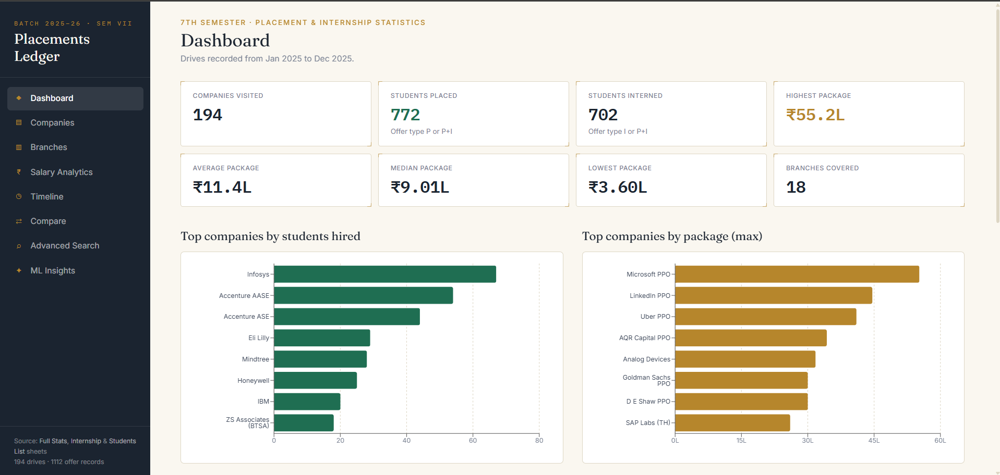

# Placement Analytics

An interactive campus placement and internship analytics dashboard built with React, TypeScript, and Python. The project converts a private Excel workbook into an anonymized aggregate JSON dataset and provides company, branch, salary, timeline, search, comparison, and experimental ML views.



## Highlights

- Explore 194 companies, 18 branches, and 1,112 placement and internship offer records.
- Filter companies by branch, category, drive type, package, hiring count, and visit month.
- Search using deterministic natural-language rules such as `CSE companies offering more than 10 LPA`.
- Compare two to five companies across packages, hiring volume, branches, dates, and stipends.
- Export filtered company results as CSV.
- Inspect salary distributions, recruiting timelines, branch outcomes, and statistical package outliers.
- Regenerate the anonymized frontend dataset through a documented Python pipeline.

## Tech stack

| Layer | Technologies |
| --- | --- |
| Frontend | React 19, TypeScript, Vite, React Router |
| Styling | Tailwind CSS |
| Visualization | Recharts |
| Data pipeline | Python, pandas, openpyxl |
| Machine learning | scikit-learn |
| Quality checks | Oxlint, TypeScript, custom sanity tests |

## Features

### Dashboard

The dashboard summarizes companies, student offers, placement and internship outcomes, package statistics, branch distribution, drive types, and monthly activity.

### Company and branch analysis

- Searchable, sortable, and paginated company table
- Advanced filters with removable active-filter chips
- Company detail pages with branch-level hiring footprints
- Branch detail pages with recruiters and package statistics
- CSV export of the currently filtered company results

### Salary and timeline analysis

- Highest, lowest, average, and median packages
- Package distribution and top-package charts
- Average package by branch
- Monthly recruiting activity
- Clickable timeline bars that open the corresponding filtered company view

### Search and comparison

The natural-language search is rule-based and runs entirely in the browser. It translates recognized branch, package, month, drive-type, and student-count phrases into the same structured filters used elsewhere in the application. It does not call an LLM or external API.

The comparison page supports side-by-side analysis of two to five companies.

### Experimental ML insights

The Python pipeline trains a Ridge regression on `log1p(CTC)` using branch, company category, hiring-drive size, and branch diversity. The exported coefficients allow the browser to perform inference without a backend. Random Forest and Gradient Boosting models are evaluated only as comparisons and are not shipped for inference.

Evaluation groups all offers from the same company into the same fold to prevent company-level leakage:

| Evaluation | Result |
| --- | ---: |
| Eligible training rows | 575 |
| Unique company groups | 99 |
| Company-grouped 5-fold Ridge CV R² | -0.064 ± 0.682 |
| Company-grouped holdout MAE | ₹240,023 |

The negative mean grouped CV R² indicates that the model does not reliably generalize to unseen companies. The predictor is therefore presented as an educational, directional experiment rather than a production forecast or decision-making tool. The single grouped holdout produced a higher score, but it is not used to claim general performance because results vary substantially across company groups.

The anomaly view separately flags company packages with an absolute peer-group z-score of at least 2.5. A flag means that a value deserves review, not that it is incorrect.

## Data pipeline and privacy

The private source workbook contains three worksheets:

- `Full Stats`: placement-drive metadata
- `Internship`: internship-drive metadata
- `Students List`: one row per student-company offer

`Students List` is treated as the primary source for aggregate counts and package statistics. The other worksheets enrich company records with category and visit-date metadata.

The browser dataset excludes student names, registration numbers, CGPA values, phone numbers, and email addresses. Only company-level and branch-level aggregates are written to `src/data/placementData.json`.

The original Excel workbook is excluded by `.gitignore` and must not be committed. See [`data/README.md`](data/README.md) for the expected workbook structure.

## Data-quality handling

- Missing CTC values are retained where internship-only offers do not report CTC.
- Missing stipends are retained where placement-only offers do not report a stipend.
- Known category and branch-label variants are normalized.
- Unmatched company metadata remains `Unknown` rather than being guessed.
- Differences between workbook summary sheets and granular offer rows are documented instead of silently reconciled.

## Getting started

### Prerequisites

- Node.js 20.19 or newer
- npm
- Python 3.10 or newer, required only to regenerate the dataset

### Install and run the frontend

```bash
npm ci
npm run dev
```

Open the local URL printed by Vite.

### Run quality checks

```bash
npm run lint
npm test
npm run build
```

Preview the production build with:

```bash
npm run preview
```

## Regenerate the dataset

Create a Python virtual environment and install the pipeline dependencies:

### Windows PowerShell

```powershell
py -m venv .venv
.\.venv\Scripts\python.exe -m pip install -r .\requirements.txt
.\.venv\Scripts\python.exe .\scripts\process.py `
  --input "C:\path\to\placement-stats.xlsx"
```

### macOS or Linux

```bash
python3 -m venv .venv
./.venv/bin/python -m pip install -r requirements.txt
./.venv/bin/python scripts/process.py --input /path/to/placement-stats.xlsx
```

The anonymized output is written to `src/data/placementData.json` by default. A different destination can be supplied with `--output`.

## Project structure

```text
placement-analytics/
├── data/
│   └── README.md
├── docs/
│   └── dashboard-preview.png
├── scripts/
│   ├── process.py
│   └── sanity-test.ts
├── src/
│   ├── components/
│   ├── data/
│   │   └── placementData.json
│   ├── hooks/
│   ├── pages/
│   ├── types/
│   └── utils/
├── package.json
├── requirements.txt
└── vite.config.ts
```

## Limitations

- The dataset represents one placement season and should not be treated as a longitudinal trend.
- Forty-seven company records could not be reliably matched to category or visit-date metadata.
- Offer counts are not necessarily unique-student counts because one student may hold multiple offers.
- The ML predictor has weak and unstable unseen-company performance, as shown by grouped cross-validation.
- Comparison and search state reset when the page reloads because the application has no backend or persistent user storage.
- The source data does not contain reliable job-role, work-location, or eligibility-rule fields.

## Responsible use

The repository should remain private unless publication of the aggregate placement data has been authorized. The original workbook and all student-level personal information must remain private regardless of repository visibility.
